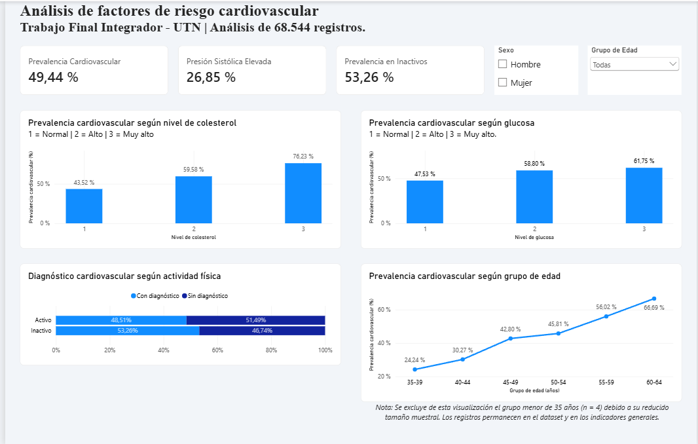

# 🫀 Trabajo Final Integrador – Análisis de factores de riesgo cardiovascular

**Autora:** Camila Martínez  
**Curso:** Herramientas Básicas para el Análisis de Datos – UTN  
**Cohorte:** Septiembre 2026

## 🎯 Objetivo

Analizar asociaciones entre factores clínicos, características físicas, hábitos de vida y diagnósticos cardiovasculares, integrando Python, Power BI y GitHub para presentar resultados claros y verificables.

## 📊 Dataset

Se utilizó el *Cardiovascular Disease Dataset* de Svetlana Ulianova, disponible en [Kaggle](https://www.kaggle.com/datasets/sulianova/cardiovascular-disease-dataset). Contiene 70.000 registros originales con información sobre edad, sexo, peso, altura, presión arterial, colesterol, glucosa, tabaquismo, alcohol, actividad física y diagnóstico cardiovascular.

## 🛠️ Metodología

El análisis se desarrolló en Google Colab con Python, Pandas, Matplotlib y Seaborn. Se revisaron tipos de datos, valores faltantes, duplicados y valores atípicos. Se aplicaron controles de consistencia sobre presión arterial, altura y peso, conservando 68.544 registros (97,92 %).

También se convirtió la edad de días a años aproximados y la altura a metros, y se calculó el índice de masa corporal (IMC). La exploración incluyó estadísticas descriptivas, detección de extremos mediante IQR y percentiles, gráficos e indicadores reproducibles.

## 📈 Resultados principales

La prevalencia cardiovascular fue del **49,44 %**. El **26,85 %** de los registros presentó presión sistólica de al menos 140 mmHg; entre las personas inactivas, la prevalencia cardiovascular alcanzó el **53,26 %**. También se observaron mayores porcentajes de diagnósticos positivos con niveles elevados de colesterol y glucosa y en grupos de mayor edad.

## 🔎 Conclusiones y limitaciones

Los resultados identifican asociaciones, no relaciones causales, y no deben generalizarse automáticamente a otras poblaciones. Durante la limpieza se excluyeron 1.456 registros (2,08 %); esta selección puede influir en las estimaciones obtenidas.

## 📁 Dashboard y archivos

Se construyó un dashboard en Power BI con tres indicadores, cuatro gráficos y filtros por sexo y grupo de edad.

- [Notebook de Python](notebooks/TP_final_Martinez_Camila.ipynb)
- [Dataset original](data/raw/cardio_train.csv)
- [Dataset procesado](data/processed/cardio_limpio.csv)
- [Dashboard de Power BI](dashboard/TP%20final%20Martinez%20Camila%20-%20Cardiovascular.pbix)

## ▶️ Cómo reproducir el análisis

1. Descargar `cardio_train.csv` desde `data/raw`.
2. Abrir el notebook en Google Colab y cargar el CSV en la sesión.
3. Ejecutar las celdas en orden para obtener la limpieza, los gráficos y los indicadores.
4. Descargar el `.pbix` desde `dashboard` y abrirlo con Power BI Desktop para explorar el panel interactivo.
